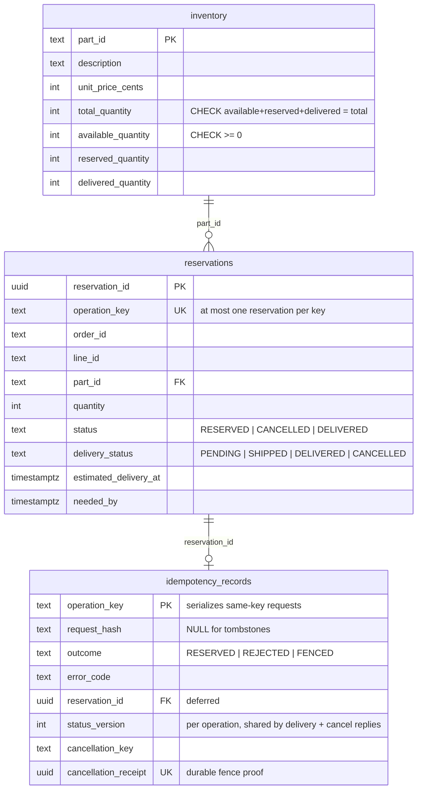
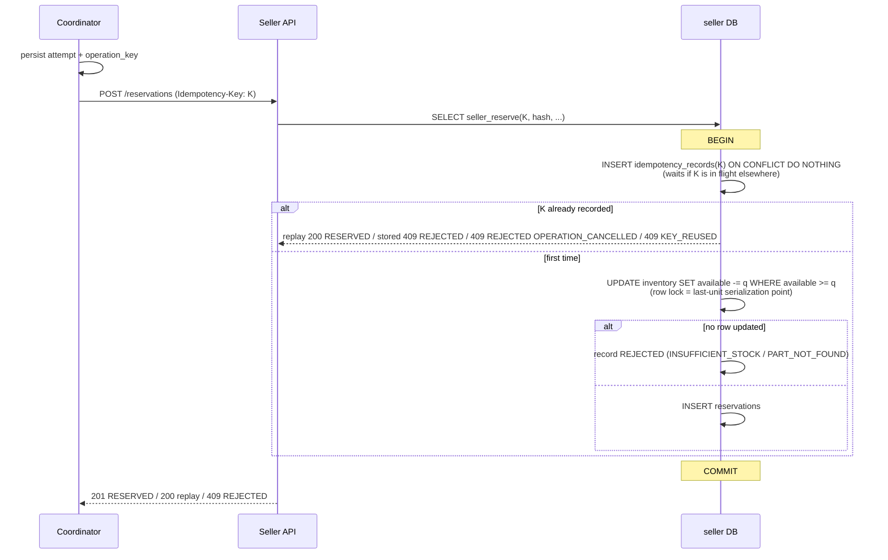
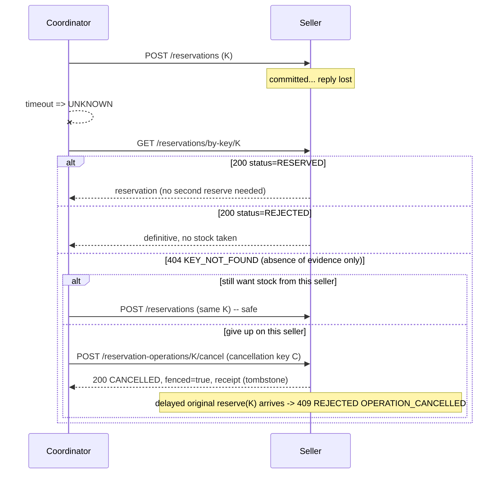
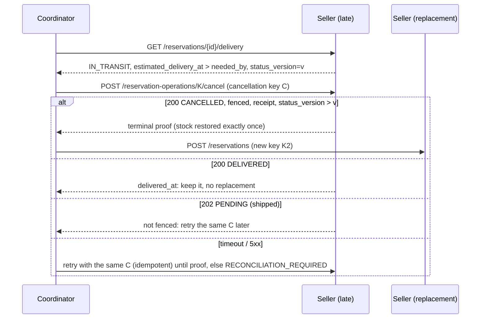

# Seller storage (Package C)

Five seller instances, one image, one database each (`seller1_db` … `seller5_db`,
in the shared Postgres container, isolated by role + CONNECT privilege).

## Schema

## Reserve: one transaction, one round-trip (`seller_reserve`)

## Timeout → reconcile → retry or fence

## Late delivery → confirmed cancellation → replacement

