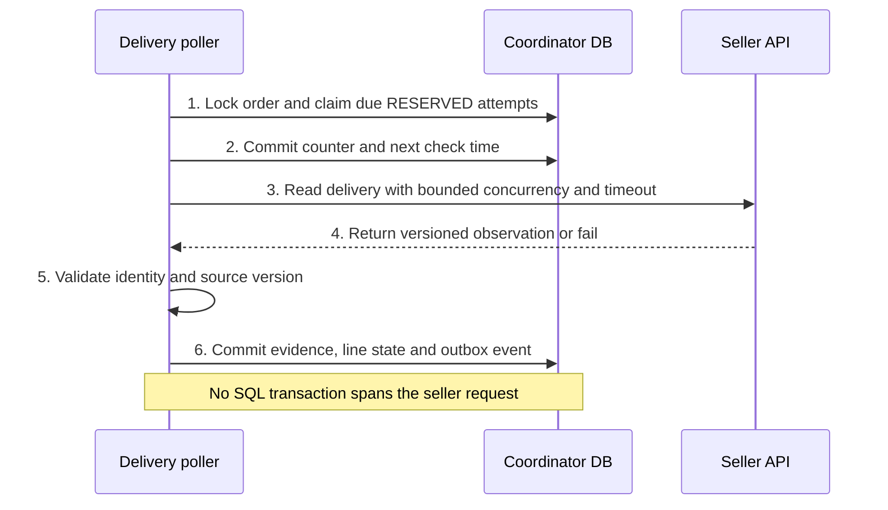

# Delivery observations and late detection

## Local verification
With PostgreSQL running, activate services/coordinator/.venv, then:

```bash
python -m alembic upgrade head
COORDINATOR_POSTGRES_TESTS=1 python -m pytest -q
```

Migration **0003_delivery_polling** adds delivery_checks, preserving existing
accepted orders, attempts, reservation keys and outbox records. No data reset or
old migration rewrite is used. Apply all migrations through 0005_workflow_jobs
and restart older processes before checking current readiness.

If the Kafka container is also running, use both opt-ins:

```bash
export COORDINATOR_KAFKA_BOOTSTRAP_SERVERS=localhost:19092
COORDINATOR_POSTGRES_TESTS=1 COORDINATOR_KAFKA_TESTS=1 python -m pytest -q
```

The new PostgreSQL tests use unique generated order IDs and remove only those
records. Cleanup handles delivery_checks before its parent attempt rows.

## Controlled delivery demo with real coordinator PostgreSQL

```bash
python -m app.tools.demo_delivery
```

No Kafka broker or real C service is needed for this particular demo. It creates
a fresh two-line order (bumper and mirror), using real coordinator persistence
and locks with an explicitly controlled in-process seller and clock.

Expected:

1. before: both lines RESERVED, order version 8.
2. after_first_poll: bumper still RESERVED with DELIVERY_AFTER_DEADLINE; mirror
   DELIVERED. Order RECONCILIATION_REQUIRED, version 10.
3. immediate_repeat_skipped: true. A new poller honors the saved due time.
4. after_due_poll: simulated clock advances 11 seconds; bumper now has delivery
   proof too. Both lines DELIVERED, order FULFILLED, version 11.
5. seller_reserve_calls=2, seller_delivery_calls=3; one attempt per line throughout.

The late ETA is a warning about a forecast. A later explicit delivered response
can resolve it; the demo does not perform a cancellation or replacement.
The controlled clock avoids waiting and does NOT establish real elapsed-time
performance or an OS-process restart. Seller records are in-memory fixtures,
not C's persistent stock database. Demo orders remain for inspection.

## Poll actual C APIs later

```bash
python -m app.tools.poll_delivery --order-id YOUR_ORDER_ID
```

This command calls configured seller URLs. It runs one bounded due batch for one
order and exits. It is not started by uvicorn and is not a background scheduler.
The automatic scheduler and restart recovery are described in SCHEDULER.md. Each newly created
DeliveryPoller reads the durable schedule and evidence, so fresh drivers respect
previous checks/backoff. Calls before next_poll_at send no request or event.

New optional settings, with defaults when absent from .env:
- COORDINATOR_DELIVERY_POLL_SECONDS=10
- COORDINATOR_DELIVERY_POLL_CONCURRENCY=5
- Existing COORDINATOR_SELLER_TIMEOUT_SECONDS also bounds each delivery call.

Failed reads double the delay, capped at max(base interval, 60 seconds). Delay
is scheduled from completion of the failed call. Polling is periodic observation
of active reservations, not an unlimited write retry: it never reserves again.
The pre-call saved due time provides a crash guard, and successful observations
schedule the next read from their completion. Confirmed delivery clears the
schedule and stops polling that attempt.

## Provisional contract requiring C's review

GET /reservations/{reservation_id}/delivery:

```json
{
  "seller_id": "seller-1",
  "operation_key": "reserve-existing-key",
  "reservation_id": "reservation-123",
  "part_id": "bumper",
  "quantity": 1,
  "status": "IN_TRANSIT",
  "status_version": 1,
  "estimated_delivery_at": "2030-01-02T12:00:00Z",
  "delivered_at": null
}
```

DELIVERED requires delivered_at; IN_TRANSIT requires ETA and no delivered_at.
Timestamps must have offsets. status_version is a positive integer, monotonically
increasing PER RESERVATION when status/ETA/evidence changes, stable on identical
reads, and durable across C restarts. It is separate from B's per-order outgoing
state_version. These are proposed C semantics, not a claim C implemented them.
Agree/translate in app/clients/delivery.py before live integration. Do not replace
version ordering with timestamps; differing UTC offsets are normalized for
equivalent observations.

B checks seller, original key, reservation, part and quantity against its saved
attempt. Lower source versions and conflicting same-version payloads cannot
overwrite the last accepted evidence. A 404, timeout, malformed reply or wrong
identity does not prove cancellation, delivery or loss of the reservation.
Only RESERVED attempts are polled. UNKNOWN attempts still use reconciliation.

## Customer-facing state and event semantics

- Late ETA: retain known RESERVED line/attempt and original key; reason
  DELIVERY_AFTER_DEADLINE makes the order RECONCILIATION_REQUIRED.
- Deadline passed without delivery proof: retain the last known reservation;
  reason DELIVERY_DEADLINE_PASSED_UNCONFIRMED makes uncertainty explicit.
- Read failure before deadline: keep the known reservation/ETA; expose
  delivery_poll_error/failure count and scheduled retry separately.
- Valid DELIVERED evidence: line and attempt DELIVERED. All lines delivered ->
  order FULFILLED; delivered + unfulfilled only -> PARTIALLY_FULFILLED.
  Delivered + reserved remains RESERVED until the remaining deliveries arrive.
  FULFILLED means all arrived; DELIVERED_AFTER_DEADLINE preserves actual lateness.
- No seller switch, cancellation, stock release or new reservation occurs here.
  Confirmed cancellation and replacement are described in REPLACEMENT.md.

Changes and outgoing events commit in one local transaction. Proposed events:
line.delivery_updated, line.delivery_delayed, line.delivery_check_deferred,
line.delivered. All retain the existing B outbox protocol and per-order version.
Identical observations/repeated identical failures do not flood progress events.
Internal poll counters/schedules still update durably. Cleared errors and newly
overdue deadlines emit visible changes. D must review the new fields/statuses.

## Numbered observation flow



The per-order PostgreSQL lock also excludes reservation/reconciliation drivers.
Result recording rechecks the current attempt/state so an obsolete reply cannot
complete a replacement attempt. Terminal delivered state never regresses.

## Verification limits
See VERIFICATION.md for recorded PostgreSQL/Kafka and controlled demo results.
The delivery demo uses a controlled seller and clock; it does not establish
live C/D compatibility, elapsed-time performance or seller persistence. The
separate process restart demo is documented in SCHEDULER.md. Live integration,
broader deployment verification, benchmarks and final report remain pending.
